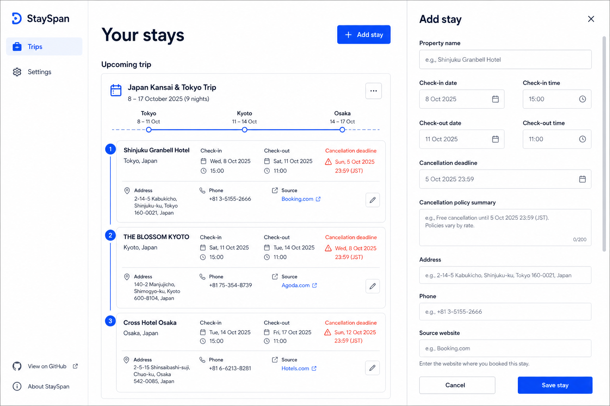
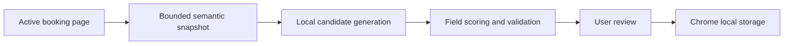

# StaySpan

<p align="center">
  
</p>

<p align="center">
  <strong>Every stay, deadline, and check-in detail in one private timeline.</strong>
</p>

<p align="center">
  <a href="https://github.com/ayushhagarwal/stayspan/actions/workflows/ci.yml"></a>
  <a href="LICENSE"></a>
  
  
</p>

StaySpan is a local-first, open-source Chrome extension that turns scattered hotel confirmation pages into a clear trip timeline. It extracts the details travelers routinely need—check-in, check-out, cancellation deadlines, address, and contact information—then lets the user verify everything before saving.

StaySpan has no account system, backend, telemetry, or remote AI dependency. Booking data remains in the browser.

> **Project status:** active early development. StaySpan is currently distributed as an unpacked Chrome extension and has not been published to the Chrome Web Store.



## Why StaySpan?

Hotel bookings often live across multiple providers. The information needed during a trip is buried in different confirmation pages, policy sections, and emails. StaySpan provides one consistent view without becoming another travel account or sending sensitive booking details to a server.

### Product principles

- **Local first:** extraction and storage happen on the device.
- **Verify, then trust:** uncertain values are visibly flagged for review.
- **Provider independent:** the extractor uses page semantics, not website-specific adapters.
- **Gracefully incomplete:** every field is optional and can be filled later.
- **Narrow by design:** V1 focuses on hotel and accommodation stays.

## Features

- Scan the active booking page using a deterministic semantic extraction engine.
- Understand structured data, headings, labels, layout proximity, dates, contact links, and cancellation language.
- Score every extracted field and flag lower-confidence values.
- Organize consecutive stays automatically and manually group exceptions into one trip timeline.
- Highlight cancellation deadlines and check-in/check-out times.
- Add, edit, or save incomplete stays manually.
- Export local data as JSON.
- Work without an account, server, API key, or network request from StaySpan.

## How extraction works



The injected collector only reads visible semantic signals. Interpretation happens inside the extension using independent scorers for property name, dates, cancellation policy, address, and phone. Candidate values are checked for chronology and false positives such as booking IDs mistaken for phone numbers.

Production extraction code contains no booking-provider hostnames or provider-specific selectors. See [Architecture](docs/ARCHITECTURE.md) for the technical design.

## Privacy and permissions

StaySpan requests only the permissions needed for its core workflow:

| Permission | Purpose |
| --- | --- |
| `activeTab` | Access the current page only after the user clicks StaySpan. |
| `scripting` | Run the bounded semantic collector on that page. |
| `storage` | Save reviewed stays locally in Chrome. |

StaySpan does not request browsing history, cookies, identity, background host access, or access to every website by default. See [Security](SECURITY.md) for responsible disclosure.

## Install locally

### Requirements

- Node.js 22 or newer
- pnpm 11
- A Chromium-based browser with Manifest V3 support

```bash
git clone https://github.com/ayushhagarwal/stayspan.git
cd stayspan
corepack enable
pnpm install --frozen-lockfile
pnpm build
```

Then:

1. Open `chrome://extensions`.
2. Enable **Developer mode**.
3. Select **Load unpacked**.
4. Choose the generated `dist` directory.

After rebuilding, click **Reload** on the StaySpan extension card.

## Development

```bash
pnpm dev       # dashboard preview at http://127.0.0.1:5173/dashboard.html
pnpm test      # deterministic extraction and UI tests
pnpm lint      # static analysis
pnpm build     # type-check and create the extension bundle
```

The test suite uses fictional, sanitized booking fixtures. Never commit real booking pages, confirmation numbers, personal addresses, or user data.

## Project structure

```text
src/
├── dashboard/   Trip timeline and review editor
├── extraction/  Semantic collector, scoring engine, and confidence types
├── popup/       Active-page scan workflow
└── shared/      Storage, formatting, trip grouping, and data types
public/          Manifest and extension icons
```

## Current limitations

- English-language booking pages and common English date formats are supported first.
- Closed shadow roots, image-only confirmations, PDFs, and cross-origin iframe-only content require manual entry.
- Extraction quality depends on the semantic information visible in the page.
- Phone numbers are intentionally omitted when a reliable contact context is unavailable.

## Roadmap

- Expand sanitized fixture coverage across more booking-layout patterns.
- Add localization dictionaries and locale-aware date parsing.
- Add import support and richer data portability.
- Improve accessibility and keyboard workflows.
- Package the extension for store review after the extraction engine stabilizes.

See the [product specification](docs/PRODUCT.md) for goals, success criteria, and non-goals.

## Contributing

Contributions are welcome. Start with [CONTRIBUTING.md](CONTRIBUTING.md), use the issue templates, and read the [Code of Conduct](CODE_OF_CONDUCT.md).

Good first contributions include sanitized extraction fixtures, accessibility improvements, documentation, tests, and carefully scoped UI refinements. Provider-specific production selectors will not be accepted.

## Community and support

- Use [GitHub Issues](https://github.com/ayushhagarwal/stayspan/issues) for reproducible bugs and scoped feature proposals.
- Use [GitHub Discussions](https://github.com/ayushhagarwal/stayspan/discussions) for questions and open-ended ideas.
- Follow [SECURITY.md](SECURITY.md) for vulnerabilities or privacy concerns; do not file those publicly.

## License

StaySpan is available under the [MIT License](LICENSE).
